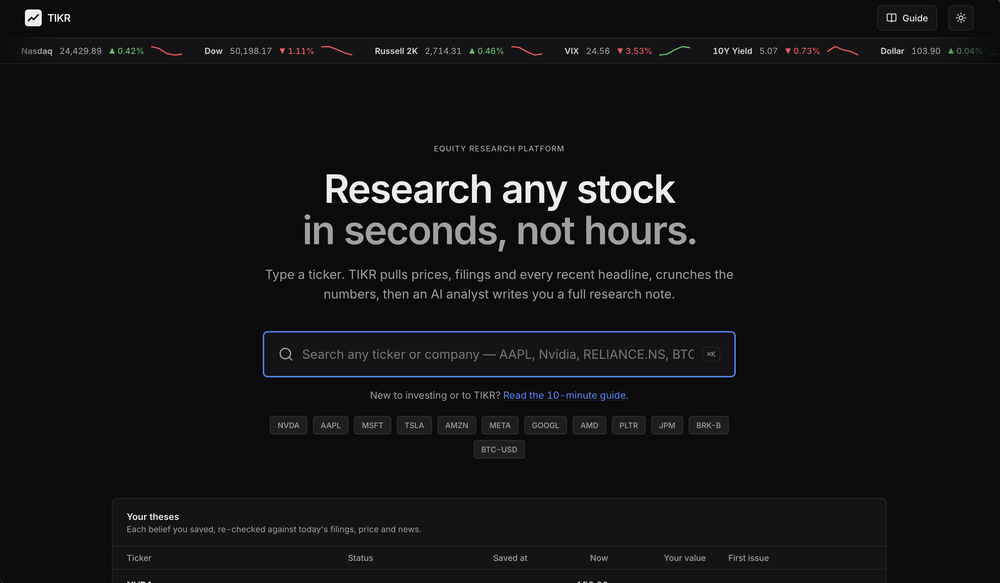
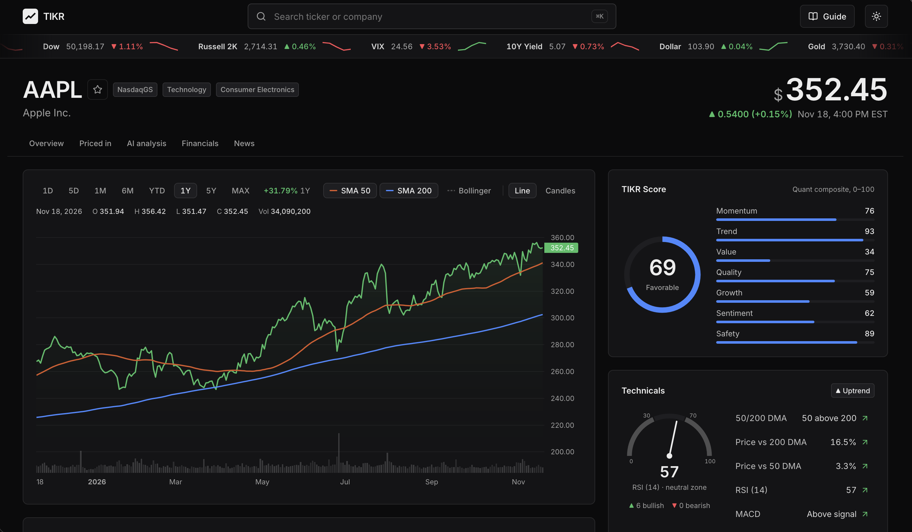
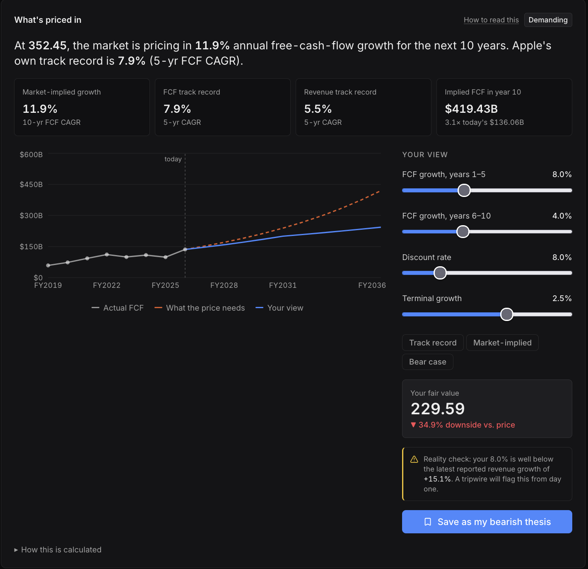

# TIKR — AI stock research terminal


Type any ticker and TIKR builds a full research dossier in a few seconds. It pulls prices, SEC filings and every recent headline, computes technicals and a quant scorecard, and then an AI analyst writes a research note you can question further.

All data sources are free and need no keys. The AI layer is optional: without a key, a built-in rules-based analyst writes the note.



## What you get

| Panel | Source | Notes |
|---|---|---|
| Live quote & market tape | Yahoo Finance `v8/chart` | Indices, VIX, 10Y, dollar, gold, crude, BTC/ETH |
| Interactive chart | Yahoo Finance | 1D → MAX, line or candles, volume, SMA 50/200, Bollinger, OHLC crosshair |
| Fundamentals & ratios | **SEC EDGAR XBRL** (`companyfacts`) | TTM revenue, margins, EPS, FCF, balance sheet, P/E, P/S, P/B, FCF yield, ROE, growth, 8-year history charts |
| SEC filings | EDGAR `submissions` | 10-K / 10-Q / 8-K / proxy, plus insider Form 4s |
| News intelligence | **Google News RSS → JSON** + Yahoo | 4 targeted queries fanned out in parallel, de-duplicated, capped per day for 30-day coverage, finance-lexicon sentiment, topic tags |
| Technicals | computed locally | RSI, MACD, Bollinger %B, ATR, volatility, max drawdown, beta vs SPY, support/resistance, signal list |
| TIKR Score | computed locally | 0–100 composite from momentum, trend, value, quality, growth, sentiment and safety |
| Related tickers | Yahoo recommendations | 1-year return comparison |
| **AI research note** | Claude + live web search | Verdict, fair-value range, bull/bear case, catalysts, risks; streamed with the sources it consulted |
| **Ask the analyst** | Claude | Follow-up Q&A grounded in the dossier |
| **What's priced in** | reverse DCF over SEC cash flows + live 10Y yield | Market-implied growth vs. track record, plus your own view with sliders |
| **Thesis tripwires** | your saved view vs. fresh data | Bullish or bearish theses re-checked on every visit; home-page board |

### What's priced in + Thesis tripwires


Most tools tell you what is happening. TIKR also answers the two questions that decide whether an investment works.

1. **What does today's price assume?** A reverse-DCF turns the live price into the free-cash-flow growth the market is betting on, for example *"the market is pricing in 11.7% a year for 10 years; Apple's own record is 7.9%"*. It's built from SEC cash flows, the live 10-year Treasury yield and the stock's beta. The result is compared with the company's own FCF and revenue track record and labeled undemanding, in line, demanding or heroic.
2. **When am I wrong?** Drag the sliders to set your own view and save it as a bullish or bearish thesis. TIKR turns it into tripwires that rerun on every visit:
   - growth vs. your assumption
   - free-cash-flow margin drift
   - price vs. your value
   - market-implied growth vs. yours
   - news-tone shift
   - your own reconsider price
   - new 10-K, 10-Q or 8-K filings since you saved

   The home page lists all your theses, worst first. The AI analyst also receives the priced-in numbers and is asked to judge whether they're achievable.

Banks, insurers and REITs, and companies with negative free cash flow, are flagged as unsupported instead of being given a misleading number. Theses are stored in your browser.

It works with US and global equities, ETFs, indices, crypto, futures and FX: anything with a Yahoo Finance symbol (`AAPL`, `BRK-B`, `RELIANCE.NS`, `7203.T`, `BTC-USD`, `^GSPC`). SEC fundamentals are available for US filers only.

## Quick start

```bash
npm install
cp .env.example .env.local   # optional: choose an AI engine, set SEC_USER_AGENT
npm run dev                  # http://localhost:3000
```

Production: `npm run build && npm start`.

### Choosing the AI engine

One setting in `.env.local` picks what writes the research note and answers questions:

| `TIKR_AI_PROVIDER` | Uses | Billed to |
|---|---|---|
| `auto` (default) | API if a key is set, else Claude Code if installed, else built-in | depends |
| `api` | Claude API via `ANTHROPIC_API_KEY` | your API account |
| `claude-code` | The **Claude Code CLI installed on this machine** (`claude -p`), using its own login | your Claude Code plan (e.g. Pro/Max) |
| `local` | Built-in rules-based analyst, no AI | free |

**Claude Code mode** runs the CLI headless and locks it down:
- **Isolated:** it runs in an empty temp folder, so no project files or `CLAUDE.md` are loaded.
- **Restricted tools:** only `WebSearch` and `WebFetch` are available, with no MCP servers, no slash commands and no saved session.
- **Your login, not your key:** `ANTHROPIC_API_KEY` is stripped from its environment, so it uses the CLI's own login even if a key is also set.

To set it up, install Claude Code, run `claude` once to sign in, then set `TIKR_AI_PROVIDER=claude-code`. If the setting can't be satisfied (no key, or CLI not found), the app says why in the AI panel and falls back to the built-in analyst.

### Configuration (`.env.local`)

| Variable | Default | Purpose |
|---|---|---|
| `TIKR_AI_PROVIDER` | `auto` | `auto` / `api` / `claude-code` / `local`. See above. |
| `ANTHROPIC_API_KEY` | — | Key for `api` mode |
| `TIKR_MODEL` | `claude-opus-5-5` | Model for `api` mode |
| `TIKR_CLAUDE_BIN` | `claude` | Path to the Claude Code CLI if it isn't on `PATH` |
| `TIKR_CLAUDE_CODE_MODEL` | CLI default | Model for `claude-code` mode |
| `TIKR_CLAUDE_CODE_TIMEOUT_MS` | `300000` | Stops a Claude Code run that takes longer than this |
| `TIKR_EFFORT` | `high` | `low` / `medium` / `high` / `xhigh` / `max`, for both engines. Lower is faster and cheaper. |
| `TIKR_WEB_SEARCH` | `1` | Lets the analyst run up to 6 web searches per note (3 per question). Set to `0` to turn this off. |
| `SEC_USER_AGENT` | generic | The SEC asks automated clients to identify themselves. Set it to `"YourApp your@email.com"`. |

If you're behind an HTTP proxy, Node's built-in `fetch` ignores `HTTPS_PROXY` unless you start it with `NODE_USE_ENV_PROXY=1` (Node ≥ 22.21).

## How it works

```
browser ──► /api/dossier/:symbol ──► lib/research.ts
                                      ├─ yahoo.ts    chart (5y daily), search, peers
                                      ├─ sec.ts      CIK lookup, XBRL facts → TTM + ratios, filings
                                      ├─ news.ts     Google News RSS ×4 + Yahoo → dedupe → sentiment
                                      ├─ indicators.ts  RSI/MACD/BB/ATR/vol/beta/returns
                                      └─ scores      7-factor composite
browser ──► /api/analyze/:symbol (NDJSON stream) ──► lib/llm.ts
                                      └─ Claude (adaptive thinking, web search, refusal fallback)
```

- **No paid market-data API.** Yahoo's public chart and search endpoints need no key or crumb. Fundamentals come straight from SEC XBRL filings. TTM figures are computed as FY + latest YTD − prior-year YTD, and share classes are summed (e.g. GOOGL + GOOG).
- **Caching.** An in-memory TTL cache with in-flight de-duplication sits in front of every upstream call: quotes for 60s, news for 5 minutes, SEC facts for 6 hours, the ticker map for 24 hours.
- **Streaming.** The report streams to the browser as NDJSON events (`status`, `source`, `text`, `done`, `error`). Web searches Claude runs show up live, with links to their sources.
- **Graceful degradation.** Every source is optional except price history. If the LLM call fails, the page falls back to the quant note.

## Project layout

```
app/                 Next.js App Router pages + API routes
  api/dossier|analyze|ask|chart|market|search
  t/[symbol]/        ticker dashboard
  guide/             plain-language tutorial
components/          UI (chart, panels, AI report, news, search, theme)
  guide/             tutorial page + theme-aware illustrations
lib/                 data sources, indicators, scoring, LLM
```

A plain-language guide with illustrations of every tool lives at **`/guide`**. It's linked from the header, the home page and the "What's priced in" panel.

Built with Next.js 15, React 19, Tailwind, TradingView Lightweight Charts, Recharts and the Anthropic SDK. It has dark and light themes, a watchlist and recent tickers (stored in your browser), and `⌘K` opens search.

> For research and education only. Not investment advice. Quotes may be delayed. Google News RSS is intended for personal, non-commercial use, so check each source's terms before deploying publicly.
